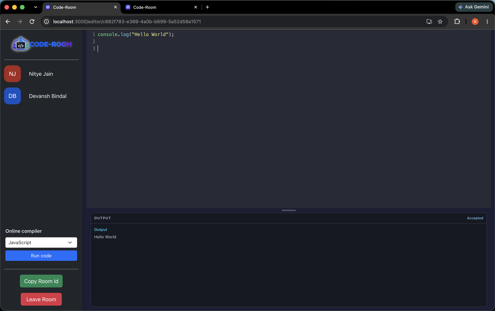

# Code-Room | Real-Time Collaborative Code Editor

Code-Room is a real-time collaborative coding platform that allows multiple users to write, edit, and execute code together in a shared room. It features live code synchronization, room management, and an integrated online compiler.

## Preview



## Features

- **Create & Join Rooms:** Create a coding room or join an existing room using its unique Room ID.
- **Real-Time Code Sync:** Synchronize code changes between users in the same room using Socket.IO.
- **User Identification:** View participants and their usernames in the room sidebar.
- **Copy Room ID:** Copy and share the room ID to invite collaborators.
- **Leave Room:** Exit a coding session when finished.
- **Online Compiler:** Select a supported programming language and execute code directly in the application.
- **Output Panel:** View program output, compilation errors, and execution results.
- **Code Editor:** Write code with syntax highlighting using CodeMirror.
- **Notifications:** Receive application feedback through toast notifications.

## Tech Stack

| Technology | Purpose |
|---|---|
| React.js | Frontend UI |
| JavaScript | Application logic |
| Bootstrap | Responsive styling |
| CodeMirror 5 | Code editor and syntax highlighting |
| Node.js | Backend runtime |
| Express.js | Backend server and API endpoints |
| Socket.IO | Real-time communication and code synchronization |
| React Router DOM | Frontend navigation |
| React Avatar | User avatars |
| React Hot Toast | Notifications |
| UUID | Unique room identifiers |
| Axios | HTTP requests to the compiler service |
| Judge0 API | Code execution and compilation |
| Git & GitHub | Version control |

## Getting Started

### Prerequisites

- [Node.js and npm](https://nodejs.org/)
- Git
- A configured Judge0 API key if required by your compiler integration

### 1. Clone the Repository

```bash
git clone https://github.com/NityeJain1008/Code-Room.git
cd Code-Room
```

### 2. Start the Backend

Open a terminal and navigate to your backend directory. The following example assumes it is named `server`.

```bash
cd server
npm install
npm start
```

If your backend uses a development script, run `npm run dev` instead.

Configure the required environment variables for your compiler integration. Never commit API keys to GitHub.

### 3. Start the Frontend

Open a second terminal from the project root:

```bash
cd client
npm install
npm start
```

Open the application at **http://localhost:3000**.

Keep both servers running while using the application. Ensure the frontend's Socket.IO connection and compiler API requests point to the correct backend address.

*Note: Adjust the backend directory and startup commands to match your actual project structure and `package.json` scripts.*

## How to Use

1. **Create a Room:** Enter your username and create a coding session.
2. **Invite Collaborators:** Click **Copy Room ID** and share it with others.
3. **Join a Room:** Enter your username and the shared Room ID.
4. **Collaborate:** Write code and see changes synchronized between participants in the same room.
5. **Run Code:** Select a programming language and click **Run code**.
6. **View Output:** Inspect the program's output or any returned errors in the output panel.
7. **Leave:** Click **Leave Room** to exit the session.

## Project Structure

```text
Code-Room/
├── client/       # React frontend
├── server/       # Node.js and Express backend
├── README.md
└── .gitignore
```

The actual filenames and folders may vary depending on your implementation.

## Author

**Nitye Jain**

- GitHub: [NityeJain1008](https://github.com/NityeJain1008)
- LeetCode: [nityejain1008](https://leetcode.com/u/nityejain1008/)
